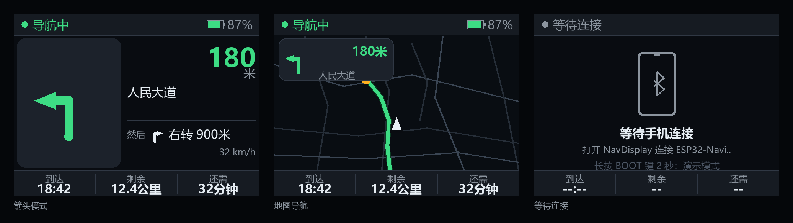

# ESP32-S3 2.8" 蓝牙导航副屏

把 iPhone 算好的路线和导航指令，通过 BLE 推到一块 2.8 寸屏上：**矢量地图随车头旋转 + 转向箭头 + 距离 + 到达时间**。



---

## 一、先说清楚能做什么、不能做什么

| 能做 | 不能做 |
| --- | --- |
| 矢量地图：路线 + 周边道路，随航向旋转 | 栅格/卫星地图、高德/苹果地图的画面镜像 |
| 显示转向箭头（左/右/掉头/环岛/匝道…） | 抓取 Apple 地图 / 高德的系统导航语音或路线 |
| 显示到路口的距离、下一条指令、ETA、剩余里程/时间 | 免 App 直接用（iOS 不开放导航数据给蓝牙外设） |
| 路线/POI 可选 Apple 地图或高德（填 Web 服务 Key） | 替代 CarPlay |
| 显示手机电量、连接状态、数据超时告警 | 在 Windows 上直接编译 iOS App（可用 GitHub Actions 代编） |
| 没手机时长按 BOOT 进演示模式自检 | |

原因是 iOS 不向第三方 BLE 外设开放系统导航状态。所以本项目是「自己算路」：

```
iPhone App
 ├─ 路线/POI：Apple MapKit 或 高德 Web 服务（App 内切换）
 ├─ 周边道路：OpenStreetMap Overpass
 └─ CoreLocation 跟随
        │  BLE GATT：JSON 指令 3~5Hz ＋ 二进制矢量地图/位置
        ▼
ESP32-S3（NimBLE 收包 → 解析 → 本地渲染旋转地图 → LovyanGFX 绘屏）
        │  SPI 40MHz
        ▼
2.8" ST7789 240x320
```

---

## 二、硬件

| 件 | 说明 | 参考价 |
| --- | --- | --- |
| ESP32-S3 开发板 | N8R2 / N16R8 都行，带 USB 口 | ¥25~45 |
| 2.8 寸 ST7789 240x320 SPI 屏 | 8 针：VCC/GND/SCL/SDA/RES/DC/CS/BLK | ¥15~30 |
| 杜邦线 8 根 | 母对母 | ¥3 |
| USB 供电 | 车充 5V/1A 以上 | — |

接线见 **[docs/wiring.md](docs/wiring.md)**，默认引脚如下，全部在 `firmware/include/config.h` 里可改：

| 屏幕 | ESP32-S3 |
| --- | --- |
| VCC | 3V3 |
| GND | GND |
| SCL | GPIO12 |
| SDA | GPIO11 |
| RES | GPIO14 |
| DC | GPIO13 |
| CS | GPIO10 |
| BLK | GPIO9 |

---

## 三、三步跑起来

### 1. 烧固件

需要 [PlatformIO](https://platformio.org/)（VS Code 插件或命令行都行）：

```bash
cd firmware
pio run -t upload          # 编译并烧录
pio device monitor         # 看日志，115200
```

看到这几行就对了：

```
[ui] 屏幕 320x240 旋转 1
[ble] 广播中，名称 "ESP32-Navi"
[sys] 就绪：手机打开 NavDisplay App 即可连接
```

**没装 PlatformIO？** 也可以用预编译固件（默认引脚、8MB Flash、无 PSRAM 配置）：

```bash
cd firmware
pip install esptool
esptool.py --chip esp32s3 -p COM5 -b 460800 \
  write_flash 0x0 prebuilt/esp32-nav-display-v1.0.0-8MB.bin
```

> 这是**合并镜像**（bootloader + 分区表 + 应用），所以从 `0x0` 开始烧。
> 用的是 `esp32-s3-devkitc-1` 的 8MB 配置；N16R8 模块也能跑，但只会用 8MB。
> 想启用 PSRAM、改了引脚或屏幕驱动，还是自己 `pio run` 一遍。

没接手机时，**长按开发板 BOOT 键 2 秒**进入演示模式，会循环播放各种转向界面，先用它确认屏幕、颜色、方向都正常。

### 2. 编译 iPhone App

**有 Mac**：需要 Xcode 15，详细步骤见 **[docs/ios.md](docs/ios.md)**：

```bash
brew install xcodegen
cd ios && xcodegen generate
open NavDisplaySender.xcodeproj
```

选自己的开发者账号 → 真机 Run → 允许定位和蓝牙。

**没有 Mac**：用 GitHub Actions 编译出 IPA，再在 Windows 上用 Sideloadly 签名安装，
完整步骤见 **[docs/install-iphone.md](docs/install-iphone.md)**（工作流已放在
`.github/workflows/build-ios-ipa.yml`）。

### 3. 用起来

1. ESP32 上电，屏幕显示「等待手机连接」。
2. App 顶部出现 **已连接**。
3. 输入目的地 → 搜索 → 点结果，自动规划。
4. 先勾上「模拟导航」在家试一遍：App 按 50km/h 沿路线跑，屏幕会同步动。
5. 上车取消模拟 → 开始导航 → 手机固定好（App 会自动禁止息屏）。

---

## 四、目录结构

```
esp32-nav-display/
├─ firmware/                 ESP32-S3 固件（PlatformIO / Arduino）
│  ├─ platformio.ini
│  ├─ include/
│  │  ├─ config.h            接线、亮度、超时、设备名、地图缓冲
│  │  ├─ display.h           LovyanGFX 的 ST7789 设备定义
│  │  ├─ nav_data.h          状态结构体 + JSON 解析
│  │  ├─ maneuver.h          转向图标绘制
│  │  ├─ map_nav.h           矢量地图协议 / 渲染
│  │  ├─ ble_nav.h           BLE 外设
│  │  └─ ui.h                界面
│  ├─ src/                   对应实现
│  └─ prebuilt/              编译好的合并固件（可直接烧）
├─ ios/                      iPhone App（8 个 Swift 文件 + XcodeGen 配置）
│  └─ project.yml
├─ .github/workflows/        GitHub Actions：无 Mac 时自动编译 IPA
├─ docs/
│  ├─ wiring.md              接线与电源
│  ├─ protocol.md            BLE 协议（UUID / JSON / 二进制地图）
│  ├─ ios.md                 Xcode 建工程、真机、权限、高德 Key
│  ├─ install-iphone.md      没有 Mac 怎么把 App 装进 iPhone
│  ├─ troubleshooting.md     白屏/花屏/连不上/编译报错
│  └─ preview.png            界面设计稿
└─ tools/render_mockup.py    重新生成设计稿
```

---

## 五、界面说明

| 区域 | 内容 |
| --- | --- |
| 顶部条 | 连接状态（等待连接/已连接/导航中/已到达/数据超时）、手机电量 |
| 地图模式 | 全屏矢量地图：路线绿线、周边道路灰线、转向点橙点，地图随航向旋转，本车固定在下方中央 |
| 左上提示卡 | 转向图标 + 距离 + 路名（地图模式下悬浮在地图上） |
| 箭头模式 | 地图还没到时自动回退：左侧大箭头、右侧距离/路名/下一条指引 |
| 底部条 | 到达时刻、剩余里程、剩余时间 |

- 中文用 LovyanGFX 内置的 efont 点阵字库（`efontCN_16` / `efontCN_12` / `efontCN_24`），不需要外挂字库文件。
- 箭头全部由几何图形实时绘制，不占 Flash，也不会缩放模糊。
- 地图是**矢量**的：手机发坐标，屏上自己画线、旋转、裁剪——所以 10~20 KB 就能传一屏，而不是一张 150 KB 的位图。
- 优先用全屏 Sprite 双缓冲（先试 PSRAM，再试内部 RAM，都失败才退回直画），刷新不闪。

---

## 六、常用改动

| 想改什么 | 改哪里 |
| --- | --- |
| 引脚 | `firmware/include/config.h` 的 `TFT_*` |
| 亮度 | `TFT_BRIGHTNESS`（0~255） |
| 屏幕方向 | `TFT_ROTATION`，界面按 1（横屏）设计 |
| 颜色反相 / 偏色 | `TFT_INVERT_COLOR`、`TFT_RGB_ORDER_BGR` |
| 蓝牙名 | `DEVICE_NAME` |
| 超时时间 | `NAV_TIMEOUT_MS`（默认 8 秒） |
| 刷新率 | `UI_NAV_FPS`、`UI_IDLE_FPS` |
| SPI 速度 | `firmware/src/display.cpp` 的 `freq_write` |
| 地图缓冲 / 缩放 | `MAP_BUF_SIZE`、`map_nav.cpp` 里的 `SCALE`（像素/米） |

---

## 七、协议

自定义 GATT 服务 + JSON，单包 ≤182 字节。完整字段表、动作枚举、示例包见 **[docs/protocol.md](docs/protocol.md)**。

一条真实数据长这样：

```json
{"v":1,"st":"nav","mn":"left","d":180,"nx":"right","nd":900,
 "rd":"人民大道","eta":"18:42","rem":12400,"rt":1800,"spd":32,"bat":87}
```

协议和平台无关，以后想接 Android 端，只要按同样格式往特征值里写就行。

---

## 八、验证情况（重要）

| 部分 | 状态 |
| --- | --- |
| 固件编译 | ✅ `pio run` 通过：PlatformIO 6.2.0 + espressif32 6.9.0（Arduino core 2.0.17）+ LovyanGFX 1.3.0 + NimBLE-Arduino 1.4.3 + ArduinoJson 7.4.3 |
| 资源占用 | RAM 9.6%（31 KB / 320 KB，另有 24 KB 地图缓冲运行时分配），Flash 55.5%（1.75 MB / 3 MB 应用区） |
| 矢量地图固件 | ✅ 协议解析、CRC 校验、旋转投影、裁剪、分级画线全部编译通过；**未上真机跑图** |
| 预编译固件 | ✅ `firmware/prebuilt/esp32-nav-display-v1.0.0-8MB.bin`（合并镜像，1.81 MB，从 0x0 烧） |
| 固件真机 | ⚠️ 未上真机：需要你接屏幕验证引脚/颜色/方向，按 `docs/troubleshooting.md` 调 |
| iOS App | ⚠️ 源码完整（Apple/高德双数据源、地图打包、OSM 拉取、BLE 分块发送），但当前环境没有 macOS，**未在 Xcode 里编译过**；若报错请按 `docs/ios.md` 对照 |
| 高德数据源 | ⚠️ Web 服务 API 调用/解析已实现，未用真实 Key 跑过；错误码会在 App 与 Xcode 控制台显示 |
| 界面设计稿 | ✅ `docs/preview.png`，与固件箭头版布局坐标一致（地图版为动态渲染） |

---

## 九、常见问题

先看 **[docs/troubleshooting.md](docs/troubleshooting.md)**，覆盖：

- 白屏 / 花屏 / 颜色反 / 图像偏移
- 手机搜不到 ESP32、连上没数据、数据超时
- 编译报 `efontCN` 未定义、`CONFIG_BT_NIMBLE_*` 未定义、RAM 溢出

---

## 十、可以继续加的东西

- 用 ANCS 抓通知做「无 App 兜底」：能显示导航播报文字，但拿不到距离和 ETA。
- 想再进一步：换高德 iOS 导航 SDK（AMapNavi），可以拿到语音播报、后台导航、路口放大图；需要绑定 Bundle ID 并加 Pod。
- 地图数据本地缓存（把走过的 blob 存下来，进隧道/没网时继续画）。
- 手机端加语音播报（AVSpeechSynthesizer），就当省了车机。
- 低功耗：没有数据时降亮度、降刷新率。

> 地图数据来自 OpenStreetMap（Overpass API），遵循 ODbL 许可，公开演示时请署名 “© OpenStreetMap contributors”。
> 国内坐标系要注意：iOS 定位/Apple 路线是 GCJ-02，OSM 是 WGS-84，App 已默认把 OSM 转到 GCJ-02（`MapPayload.swift` 的 `GCJ.enabled`）。

## 许可

本项目代码 MIT。第三方库：LovyanGFX（BSD-2）、NimBLE-Arduino（Apache-2.0）、ArduinoJson（MIT），各自的版权归原作者。
